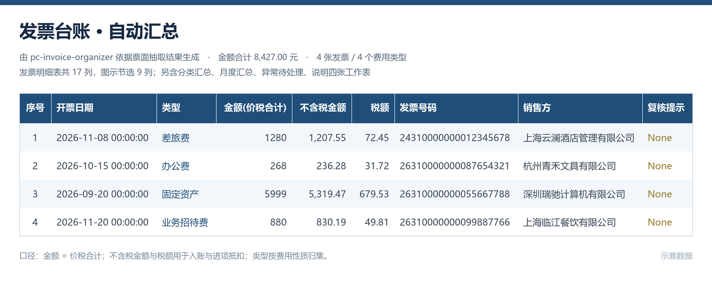
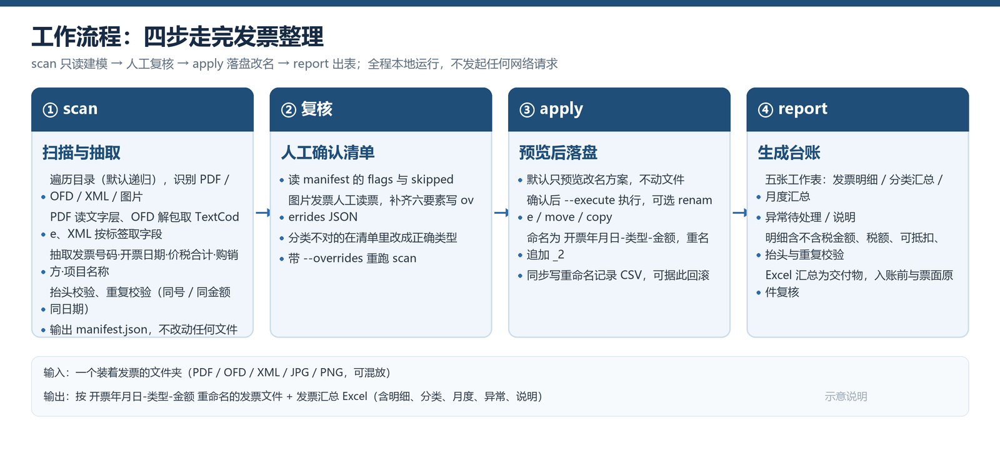

# 本地电脑发票管家 · PC Invoice Organizer

**v1.0.0** ｜ 分类：办公效率 / 票据整理（Agent Skill） ｜ 作者：Bowen ｜ 许可：[MIT](LICENSE)

[**中文**](#本地电脑发票管家--pc-invoice-organizer) ｜ [English](#english)





把电脑硬盘里散落的发票扫一遍，读出票面要素，按费用性质归类，统一改名成 `开票年月日-类型-金额`，再汇总成一份可直接交给会计的 Excel 台账。全程在本地完成，发票文件不出你的电脑。

## 特性

| 能力 | 说明 |
| --- | --- |
| 批量扫描 | 遍历指定目录及其子目录，识别 PDF / OFD / XML / 图片格式的发票，混放也能一并处理 |
| 要素抽取 | 从票面文字层提取发票号码、开票日期、金额、税额、购销双方、项目名称、税率 |
| 费用归类 | 内置 26 个费用类型、271 条关键词规则，覆盖差旅、办公、招待、固定资产、服务费等常见科目 |
| 批量改名 | 统一命名 `开票年月日-类型-金额.pdf`，重名自动追加 `_2`、`_3`，不覆盖任何原文件 |
| 校验与提示 | 抬头校验（与公司名 / 税号比对）、重复校验（同号或同额同日）、红冲票识别、固定资产阈值判断（默认 5000 元） |
| 台账汇总 | 输出含 5 张工作表的 Excel：发票明细、分类汇总、月度汇总、异常待处理、说明 |
| 可回滚 | 每次落盘同步写一份重命名记录 CSV，记录原路径与新路径，可据此还原 |
| 只预览不误动 | `apply` 默认只打印改名方案，必须显式加 `--execute` 才会动文件 |

## 支持格式与边界

| 输入格式 | 处理方式 |
| --- | --- |
| PDF（含文字层） | 直接读取文字层，抽取要素；一页一票的多页 PDF 按页拆分识别 |
| OFD | 作为 ZIP 容器解包，读取正文 XML 中的 `<TextCode>` 文本 |
| XML（数电票） | 按标签别名匹配字段 |
| JPG / PNG / BMP / TIF / WEBP | **不做自动 OCR**。脚本会把这些文件标记为「图片待人工读取」并跳过，需人工读票后写入 `overrides` JSON，再带 `--overrides` 重跑 `scan` |

关于图片发票，这是一个有意的边界：本技能不内置 OCR 引擎，也不调用任何云端识别服务。图片发票由使用者在智能体里用视觉读票补齐六要素（发票号码、开票日期、价税合计、购买方、销售方、项目名称），写进 `overrides` 后由脚本统一归类改名。宁可交人工复核，也不猜数字。

其他边界：

- 不删除、不覆盖原始文件；改名失败即跳过并记录。
- 不判定发票真伪，不承诺可抵扣或可税前扣除，不代做账务处理与纳税申报。
- 整理结果基于票面信息自动抽取，入账前必须与票面原件复核。
- 目录内超过 300 个文件时，建议先 `scan` 再分批 `apply`。

## 可导入的智能体平台

本仓库是一个 Agent Skill（能力包），导入后由智能体按 `SKILL.md` 的流程调度脚本：

- **WorkBuddy**
- **OpenClaw**
- **Hermes Agent**

把整个 `pc-invoice-organizer` 目录放进平台的 skills 目录即可，入口文件是 `SKILL.md`。

## 目录结构

```
pc-invoice-organizer/
├── SKILL.md                            # 技能说明与执行流程（智能体入口）
├── README.md
├── CHANGELOG.md
├── LICENSE                             # MIT
├── requirements.txt                    # PyMuPDF、openpyxl
├── .gitignore                          # 排除归档目录、台账、缓存
├── assets/
│   ├── icon.png                        # 1024×1024 图标
│   ├── icon-512.png                    # 512×512 图标
│   ├── screenshot-1-ledger.png         # 发票台账示意（虚构数据）
│   └── screenshot-2-flow.png           # 四步工作流程
├── references/
│   ├── category-rules.json             # 分类规则（脚本读取）
│   ├── category-rules.md               # 分类口径与税前扣除说明
│   ├── extraction-guide.md             # 抽取规则、图片发票补录、异常排查
│   └── reimbursement-checklist.md      # 报销材料与异常处理对照表
├── samples/                            # 4 张虚构样例发票（仅演示用）
│   ├── sample-01-hotel-1280.pdf
│   ├── sample-02-office-268.pdf
│   ├── sample-03-pc-5999.pdf
│   └── sample-04-meal-880.pdf
└── scripts/
    └── invoice_tool.py                 # 唯一可执行脚本：scan / apply / report
```

## 快速开始

环境要求：Python 3.9 及以上；依赖 PyMuPDF 与 openpyxl；无需联网。

```bash
python -m pip install -r requirements.txt
```

四步流程（`scan` 只读，`apply` 预览，确认后 `--execute` 落盘，最后 `report` 出表）：

```bash
# 1. 扫描：抽取要素、归类、生成清单，不改动任何文件
python scripts/invoice_tool.py scan --src "D:\发票" --company "上海某某科技有限公司" --tax-id "91310230MA1K9XXXXX" --year 2026

# 2. 预览改名方案（不落盘）
python scripts/invoice_tool.py apply --manifest "D:\发票\_发票整理归档\manifest.json"

# 3. 确认后执行（三种落盘方式）
python scripts/invoice_tool.py apply --manifest "D:\发票\_发票整理归档\manifest.json" --execute                       # 原地改名（默认）
python scripts/invoice_tool.py apply --manifest "D:\发票\_发票整理归档\manifest.json" --execute --mode move --out "D:\2026年度发票"
python scripts/invoice_tool.py apply --manifest "D:\发票\_发票整理归档\manifest.json" --execute --mode copy --out "D:\整理副本"

# 4. 生成 Excel 台账
python scripts/invoice_tool.py report --manifest "D:\发票\_发票整理归档\manifest.json"
```

常用参数：

| 参数 | 作用 |
| --- | --- |
| `--src` | 待扫描目录 |
| `--company` / `--tax-id` | 公司抬头与购方税号，用于抬头校验；不填则跳过校验 |
| `--year` | 归属年度，跨年票据会标记「归属年度不符」 |
| `--overrides` | 图片发票人工补录的 JSON，格式见 `references/extraction-guide.md` |
| `--profile` | 长期配置 JSON（公司名、税号、固定资产阈值、类型覆盖等） |
| `--fixed-asset-threshold` | 固定资产资本化标准，默认 5000 元 |
| `--no-recursive` | 只扫当前目录，不进子目录 |
| `--rules` | 指定自定义分类规则文件 |
| `--mode` / `--out` | 落盘方式（rename / move / copy）与目标目录 |
| `--manifest` / `--xlsx` / `--archive` | 清单、台账、归档目录位置 |

## 样例运行结果

`samples/` 里放了 4 张虚构发票（住宿、办公用品、笔记本电脑、餐饮），在仓库根目录实跑：

```bash
$ python scripts/invoice_tool.py scan --src samples --company "上海示例科技有限公司" --tax-id 91310230MA1K9TESTX --year 2026
识别发票：4 张，合计 8,427.00 元
未识别/跳过：0 个文件
清单已写入：samples\_发票整理归档\manifest.json

$ python scripts/invoice_tool.py apply --manifest "samples\_发票整理归档\manifest.json" --execute
处理结果：4 张文件重命名，未改动任何文件
回滚记录：samples\_发票整理归档\重命名记录_20261123122308.csv

$ python scripts/invoice_tool.py report --manifest "samples\_发票整理归档\manifest.json"
报表：汇总表已生成：samples\_发票整理归档\发票汇总_202611231223.xlsx
明细 4 行，类型 4 类，异常 0 条
```

改名效果：

| 原文件名 | 整理后 |
| --- | --- |
| `sample-01-hotel-1280.pdf` | `20261108-差旅费-1280.00.pdf` |
| `sample-02-office-268.pdf` | `20261015-办公费-268.00.pdf` |
| `sample-03-pc-5999.pdf` | `20260920-固定资产-5999.00.pdf` |
| `sample-04-meal-880.pdf` | `20261120-业务招待费-880.00.pdf` |

样例数据均为虚构，票面备注里已注明不具备法律效力。运行会在 `samples/` 下生成 `_发票整理归档/` 目录，该目录与 `*.xlsx` 已在 `.gitignore` 中排除。

## 输出台账字段

Excel 的「发票明细」工作表共 17 列，列名以实际生成为准：

| 列 | 说明 |
| --- | --- |
| 序号 | 行号 |
| 开票日期 | 取自票面开票日期，`YYYY-MM-DD` |
| 类型 | 归类结果，与文件名中的类型一致 |
| 金额(价税合计) | 票面价税合计 |
| 不含税金额 | 入账与进项抵扣依据 |
| 税额 | 票面税额 |
| 发票号码 | 8–24 位数字 |
| 票种 | 增值税专用发票 / 电子普通发票等 |
| 销售方 | 销方名称 |
| 购买方 | 购方名称 |
| 抬头校验 | 与 `--company` / `--tax-id` 比对结果 |
| 重复校验 | 唯一 / 疑似重复（N 张同号） |
| 可抵扣 | 专票且信息齐全时为可抵扣 |
| 项目/服务名称 | 票面项目行，如 `*住宿服务*住宿费` |
| 文件名 | 整理后的文件名 |
| 原始路径 | 整理前的完整路径，便于核对 |
| 复核提示 | 需要人工关注的说明 |

其余四张表：**分类汇总**（类型、张数、金额、占比、税前扣除口径、科目说明）、**月度汇总**（归属月份、张数、金额）、**异常待处理**（逐条问题与建议动作）、**说明**（生成时间、目录、口径、命名规则、归档要求）。

## 归档与命名规则

- 命名格式：`开票年月日-类型-金额.扩展名`，例 `20261108-差旅费-1280.00.pdf`。
- 日期取**开票日期**，不是文件名日期，也不是报销日期。
- 金额取**价税合计**，两位小数，不带千分位。
- 重名追加 `_2`、`_3`；疑似重复的票据同样带序号，由「重复校验」列提示。
- 负数红冲票写作 `红冲880.00`，避免文件名出现双连字符。
- 字段不全（缺日期或缺金额）的票据保留原文件名并标记，不生成「日期待补」这类无效名称。
- 清单、回滚 CSV、汇总表默认写入 `<目录>_发票整理归档/`。

## 隐私与安全

- **全本地运行**：脚本只依赖 PyMuPDF 与 openpyxl，代码中没有任何网络请求、上传逻辑或第三方接口调用。
- **不上传票据**：发票原文件、抽取结果、台账都留在本机，归档目录由你自己指定。
- **不删不改原件**：默认只改名，`--mode copy` 可完全保留原件；任何失败都跳过并记录。
- **可回滚**：每次落盘生成 `重命名记录_时间.csv`，逐条记录原路径与新路径。
- **先预览后执行**：`apply` 不带 `--execute` 时只打印方案，不会触碰文件。

## 已知限制

- 图片与扫描件不做自动 OCR，需人工读票后走 `overrides` 补录。
- 抽取基于票面文字排版与标签，版面异常、加密 PDF、残缺文件可能抽不到字段，此时会在 `flags` 中标记并保留原文件名。
- 分类依赖关键词规则，未命中任何规则会归入「其他」，可通过 `references/category-rules.json` 或 `--profile` 的类型覆盖修正。
- 不判断真伪、不计算税前扣除限额的全年累计数，只给出单张发票的口径提示。
- 归档目录内文件数很多时，扫描耗时随文件数增长。

## 环境要求

- Windows / macOS / Linux
- Python 3.9+
- PyMuPDF >= 1.23.0、openpyxl >= 3.1.0

## License

[MIT](LICENSE) © 2026 Bowen

---

## English

[中文](#本地电脑发票管家--pc-invoice-organizer) ｜ [**English**](#english)

**v1.0.0** · Category: Office Productivity / Invoice Filing (Agent Skill) · Author: Bowen · License: [MIT](LICENSE)

Scan the invoices scattered across your disk, read the fields off each document, classify them by expense nature, rename them to `YYYYMMDD-category-amount`, and roll everything into one Excel ledger you can hand to your accountant. Everything runs locally — invoices never leave your machine.

## Features

| Capability | Details |
| --- | --- |
| Batch scan | Walks a folder and its subfolders, picks up PDF / OFD / XML / image invoices, mixed formats in one pass |
| Field extraction | Invoice number, issue date, gross amount, tax, buyer, seller, item name, tax rate from the text layer |
| Expense classification | 26 expense categories with 271 keyword rules covering travel, office, entertainment, fixed assets, services and more |
| Batch rename | `YYYYMMDD-category-amount.pdf`, collisions get `_2` / `_3`, nothing is ever overwritten |
| Validation | Company header check (name / tax ID), duplicate check (same number, or same amount and date), red-letter invoice detection, fixed-asset threshold (default 5000 CNY) |
| Excel ledger | Five worksheets: invoice detail, category summary, monthly summary, exceptions, notes |
| Rollback | Every execution writes a rename-log CSV holding old and new paths |
| Dry run first | `apply` only prints the rename plan; files move only with an explicit `--execute` |

## Formats and Boundaries

| Input | Handling |
| --- | --- |
| PDF with a text layer | Text layer is read directly; multi-page PDFs are handled page by page |
| OFD | Unpacked as a ZIP container, text taken from `<TextCode>` in the body XML |
| XML (e-invoice) | Fields matched through tag aliases |
| JPG / PNG / BMP / TIF / WEBP | **No automatic OCR.** These files are flagged as "image awaiting manual reading" and skipped; read the invoice yourself, write an `overrides` JSON, then rerun `scan` with `--overrides` |

That image boundary is deliberate: the skill ships no OCR engine and calls no cloud recognition service. A human (or a vision-capable agent) reads the six fields — invoice number, issue date, gross amount, buyer, seller, item — puts them into `overrides`, and the script takes over from there. Better a manual check than a guessed number.

Other boundaries:

- Never deletes or overwrites the original files; a failed rename is skipped and logged.
- Does not verify authenticity, does not promise deductibility, does not do bookkeeping or tax filing.
- Extraction is automatic — reconcile with the original documents before posting to accounts.
- Above ~300 files per folder, run `scan` first and `apply` in batches.

## Supported Agent Platforms

This repository is an Agent Skill (capability package). Drop the `pc-invoice-organizer` folder into the platform's skills directory; the entry point is `SKILL.md`.

- **WorkBuddy**
- **OpenClaw**
- **Hermes Agent**

## Repository Layout

```
pc-invoice-organizer/
├── SKILL.md                            # skill description and workflow (agent entry)
├── README.md
├── CHANGELOG.md
├── LICENSE                             # MIT
├── requirements.txt                    # PyMuPDF, openpyxl
├── .gitignore
├── assets/
│   ├── icon.png                        # 1024×1024 icon
│   ├── icon-512.png                    # 512×512 icon
│   ├── screenshot-1-ledger.png         # ledger preview (synthetic data)
│   └── screenshot-2-flow.png           # four-step workflow
├── references/
│   ├── category-rules.json             # classification rules (read by the script)
│   ├── category-rules.md               # category semantics and deduction notes
│   ├── extraction-guide.md             # extraction rules, image override, troubleshooting
│   └── reimbursement-checklist.md      # reimbursement checklist and exception handling
├── samples/                            # 4 synthetic sample invoices (demo only)
└── scripts/
    └── invoice_tool.py                 # the only executable: scan / apply / report
```

## Quick Start

Requirements: Python 3.9+, PyMuPDF and openpyxl, no network access needed.

```bash
python -m pip install -r requirements.txt
```

Four steps (`scan` is read-only, `apply` previews, `--execute` commits, `report` produces the ledger):

```bash
# 1. Scan: extract, classify, write the manifest — no file is touched
python scripts/invoice_tool.py scan --src "D:\Invoices" --company "Your Company Ltd." --tax-id "91310230MA1K9XXXXX" --year 2026

# 2. Preview the rename plan (dry run)
python scripts/invoice_tool.py apply --manifest "D:\Invoices\_发票整理归档\manifest.json"

# 3. Commit
python scripts/invoice_tool.py apply --manifest "D:\Invoices\_发票整理归档\manifest.json" --execute                      # rename in place (default)
python scripts/invoice_tool.py apply --manifest "D:\Invoices\_发票整理归档\manifest.json" --execute --mode move --out "D:\Invoices 2026"
python scripts/invoice_tool.py apply --manifest "D:\Invoices\_发票整理归档\manifest.json" --execute --mode copy --out "D:\Invoices copy"

# 4. Build the Excel ledger
python scripts/invoice_tool.py report --manifest "D:\Invoices\_发票整理归档\manifest.json"
```

Key options:

| Option | Purpose |
| --- | --- |
| `--src` | Folder to scan |
| `--company` / `--tax-id` | Header and buyer tax ID used for the header check; omit to skip |
| `--year` | Reporting year; cross-year invoices are flagged |
| `--overrides` | JSON with manually read image invoices |
| `--profile` | Long-term config JSON (company, tax ID, asset threshold, category overrides) |
| `--fixed-asset-threshold` | Capitalisation threshold, default 5000 CNY |
| `--no-recursive` | Top level only |
| `--rules` | Custom rule file |
| `--mode` / `--out` | Commit mode (rename / move / copy) and target folder |

## Sample Run

`samples/` holds four synthetic invoices (hotel, stationery, laptop, restaurant). Actual run from the repo root:

```
识别发票：4 张，合计 8,427.00 元        # 4 invoices, 8,427.00 CNY in total
未识别/跳过：0 个文件                   # 0 files skipped
处理结果：4 张文件重命名，未改动任何文件  # 4 files renamed, no file modified
明细 4 行，类型 4 类，异常 0 条          # 4 detail rows, 4 categories, 0 exceptions
```

| Before | After |
| --- | --- |
| `sample-01-hotel-1280.pdf` | `20261108-差旅费-1280.00.pdf` |
| `sample-02-office-268.pdf` | `20261015-办公费-268.00.pdf` |
| `sample-03-pc-5999.pdf` | `20260920-固定资产-5999.00.pdf` |
| `sample-04-meal-880.pdf` | `20261120-业务招待费-880.00.pdf` |

All sample data is fictional and marked as non-legal on the document itself. A run creates `samples/_发票整理归档/`, which along with `*.xlsx` is excluded by `.gitignore`.

## Ledger Columns

The "invoice detail" sheet has 17 columns:

`序号 (No.)` · `开票日期 (issue date)` · `类型 (category)` · `金额(价税合计) (gross)` · `不含税金额 (net)` · `税额 (tax)` · `发票号码 (invoice number)` · `票种 (invoice type)` · `销售方 (seller)` · `购买方 (buyer)` · `抬头校验 (header check)` · `重复校验 (duplicate check)` · `可抵扣 (deductible)` · `项目/服务名称 (item)` · `文件名 (file name)` · `原始路径 (original path)` · `复核提示 (review note)`

The other four sheets are **category summary** (count, amount, share, deduction basis, notes), **monthly summary**, **exceptions** and **notes** (generation time, folder, conventions, naming rules, archiving requirements).

## Naming Rules

- Format: `YYYYMMDD-category-amount.ext`, e.g. `20261108-差旅费-1280.00.pdf`.
- Date comes from the **issue date**, not the file name and not the reimbursement date.
- Amount is the **gross (tax-inclusive) total**, two decimals, no thousands separator.
- Duplicate names get `_2`, `_3`; suspected duplicates also carry a suffix and are flagged in the duplicate column.
- Negative red-letter invoices are written as `红冲880.00` to avoid a double dash.
- Invoices missing a date or amount keep their original name and are flagged — no "date TBD" placeholders.
- Manifest, rename log and ledger default to `<folder>_发票整理归档/`.

## Privacy and Security

- **Fully local**: only PyMuPDF and openpyxl are used; the code contains no network calls, upload logic or third-party APIs.
- **Nothing leaves the machine**: originals, extraction results and ledgers stay on disk, in a folder you choose.
- **No deletion**: default mode only renames; `--mode copy` keeps the originals untouched; failures are skipped and logged.
- **Rollback ready**: each commit writes a `重命名记录_<time>.csv` with old and new paths.
- **Dry run by default**: `apply` without `--execute` cannot modify anything.

## Known Limitations

- No OCR for images or scans; use the `overrides` route.
- Extraction depends on the text layout; encrypted PDFs, damaged files or unusual layouts may yield missing fields — they get flagged and keep their original names.
- Classification is keyword based; unmatched invoices land in "其他" (other) and can be corrected via `references/category-rules.json` or the `--profile` overrides.
- Does not verify authenticity and does not compute annual deduction ceilings; it only shows per-invoice guidance.
- Scan time grows with the number of files in the folder.

## Requirements

- Windows / macOS / Linux
- Python 3.9+
- PyMuPDF >= 1.23.0, openpyxl >= 3.1.0

## License

[MIT](LICENSE) © 2026 Bowen
